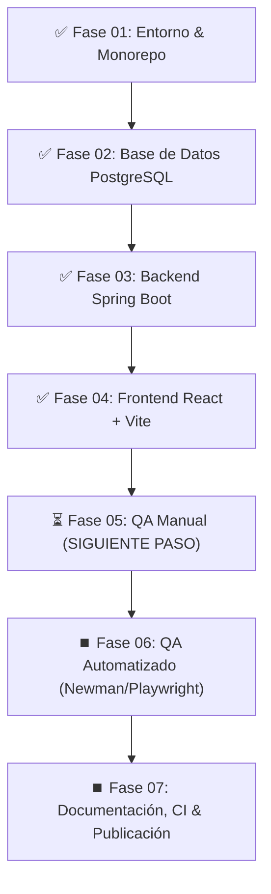

# 🧭 TaskFlow Full Stack — Contexto y Bitácora del Proyecto

> **Propósito de este documento:** Preservar el 100% del contexto técnico, el estado de avance, las decisiones arquitectónicas y los pasos a seguir. En caso de corte de sesión o consumo de tokens/créditos, cualquier asistente o desarrollador puede leer este archivo y reanudar el proyecto exactamente desde donde se dejó sin perder continuidad.

**Última actualización:** 2026-10-22  
**Ruta del Monorepo:** `D:\task.portafoli0\taskflow-fullstack`  
**Objetivo del Proyecto:** Aplicación web integral de gestión de tareas con PostgreSQL, Spring Boot, React y suite de pruebas QA (manual y automatizada) para portafolio profesional de alto impacto.

---

## 💻 1. Diagnóstico del Entorno Local

| Herramienta | Versión / Estado | Ubicación / Comando |
|---|---|---|
| **Sistema Operativo** | Windows 11 (64-bit) | — |
| **Java JDK** | `23.0.2` (Oracle JDK) | `C:\Program Files\Java\jdk-23` (establecer `$env:JAVA_HOME = "C:\Program Files\Java\jdk-23"`) |
| **Node.js** | `v22.14.0` | `node --version` |
| **npm** | `11.17.0` | `npm --version` |
| **Git** | `2.48.1.windows.1` | Inicializado en la raíz del repositorio |
| **Base de Datos** | PostgreSQL local | Puerto `5432`, BD: `taskflow_db`, Usuario: `postgres` |

---

## 📊 2. Matriz de Estado de las Fases



* **Fase 01 (Entorno & Estructura):** ✅ **COMPLETADA**
* **Fase 02 (Base de Datos):** ✅ **COMPLETADA**
* **Fase 03 (Backend Spring Boot):** ✅ **COMPLETADA**
* **Fase 04 (Frontend React):** ✅ **COMPLETADA**
* **Fase 05 (QA Manual):** ✅ **COMPLETADA**
* **Fase 06 (QA Automatizado):** ✅ **COMPLETADA**
* **Fase 07 (Documentación, CI & Publicación):** ✅ **COMPLETADA (PROYECTO 100% CONSTRUIDO)**

---

## 📂 3. Detalle de Archivos Construidos y Arquitectura

### 3.1. Raíz del Repositorio
* `README.md`: Documento maestro de presentación del proyecto con diagramas y roadmap.
* `.gitignore`: Reglas multi-lenguaje (Java/Maven/target, Node/node_modules/dist, OS, IDEs).
* `PROJECT_CONTEXT.md`: Este archivo de preservación de estado.

### 3.2. Base de Datos (`database/`)
* `database/schema.sql`: DDL en PostgreSQL con tabla `tasks` (id `BIGINT GENERATED ALWAYS AS IDENTITY`, `title`, `description`, `priority` CHECK, `status` CHECK, `created_at`, `updated_at`), índices (`idx_tasks_status`, `idx_tasks_priority`, `idx_tasks_created_at`) y trigger en PL/pgSQL para `updated_at`.
* `database/data.sql`: 6 registros semilla para poblar el sistema y probar filtros y dashboard.
* `database/README.md`: Diagrama ERD en Mermaid, diccionario de datos y guía de comandos `psql`.

### 3.3. Backend (`backend/`)
* **Framework:** Spring Boot 4 / Java 21-23. Usa Maven Wrapper (`backend/mvnw.cmd`).
* **Paquete Base:** `com.taskflow`
* **Clases implementadas:**
  * `model/`: `Task.java` (Entidad JPA), `TaskPriority.java` (Enum: LOW, MEDIUM, HIGH), `TaskStatus.java` (Enum: PENDING, IN_PROGRESS, COMPLETED).
  * `dto/`: `TaskRequestDTO.java` (Bean Validation), `TaskResponseDTO.java`, `TaskMetricsDTO.java`, `ErrorResponseDTO.java`.
  * `repository/`: `TaskRepository.java` (Consultas dinámicas JPQL `searchTasks` y conteos `countByStatus`).
  * `service/`: `TaskService.java` (Interfaz) y `TaskServiceImpl.java` (Lógica transaccional de negocio).
  * `controller/`: `TaskController.java` (`/api/tasks` con endpoints CRUD y `/metrics`).
  * `exception/`: `ResourceNotFoundException.java` y `GlobalExceptionHandler.java` (`@RestControllerAdvice` para 400, 404, 500).
  * `config/`: `CorsConfig.java` (Habilita CORS para `http://localhost:5173` y `http://localhost:3000`).
* **Configuración:**
  * `backend/src/main/resources/application.properties`: Conexión JDBC a `taskflow_db` con fallback a variables de entorno.
  * `backend/src/test/resources/application.properties`: Perfil H2 en memoria para pruebas rápidas y autónomas sin dependencia de red.
* **Pruebas Automatizadas Backend:**
  * `TaskServiceTest.java`: 6 pruebas unitarias de servicio con Mockito.
  * `TaskControllerTest.java`: 6 pruebas web con `MockMvc` (códigos 200, 201, 204, 400 y 404).
  * `TaskflowBackendApplicationTests.java`: 1 prueba de arranque del contexto Spring.
  * **Resultado:** 13 pruebas superadas al 100% (`BUILD SUCCESS`).
* `backend/README.md`: Documentación de la API y guía de ejecución.

### 3.4. Frontend (`frontend/`)
* **Tecnología:** React 18/19 + Vite + `lucide-react`.
* **Componentes implementados:**
  * `src/api/taskApi.js`: Capa desacoplada para peticiones HTTP a `/api/tasks`.
  * `src/components/Navbar.jsx`: Logo TaskFlow y botón de "+ Nueva Tarea".
  * `src/components/MetricsGrid.jsx`: 4 tarjetas métricas (Total, Pendientes, En Progreso, Completadas).
  * `src/components/FilterBar.jsx`: Buscador textual con debounce y filtros combinados por Estado y Prioridad.
  * `src/components/TaskCard.jsx`: Tarjeta interactiva con badges y botón de ciclo rápido de estado.
  * `src/components/TaskModal.jsx`: Formulario modal de creación/edición con validación en cliente.
  * `src/components/DeleteConfirmModal.jsx`: Diálogo de confirmación para borrado seguro.
  * `src/components/EmptyState.jsx`: Feedback visual cuando no hay tareas o los filtros no coinciden.
  * `src/styles/main.css`: Tema Slate Dark moderno con variables CSS, animaciones y toasts flotantes.
  * `src/App.jsx`: Estado central, orquestador de datos y notificaciones.
  * `src/main.jsx` & `index.html`: Punto de entrada con tipografía Inter.
* **Configuración:** `vite.config.js` con proxy hacia `http://localhost:8080/api`.
* **Compilación:** `npm run build` verificado exitosamente en 796 ms.
* `frontend/README.md`: Documentación de la UI y comandos.

---

## 🎯 4. Próximos Pasos Exactos (Guía para Reanudar)

Cuando se retome la sesión, continuar directamente con la **Fase 05 (QA Manual)**:

### Tareas de la Fase 05:
1. Crear `qa/manual/test-plan.md`:
   - Objetivos de calidad, alcance (funcionalidades probadas y no probadas).
   - Tipos de pruebas: Funcionales, UI/UX, límites, casos negativos y compatibilidad.
   - Criterios de entrada (Entorno listo, build exitoso) y salida (0 bugs críticos/altos).
2. Crear `qa/manual/test-cases.md`:
   - Matriz con 15+ casos de prueba detallados (ID, módulo, precondiciones, pasos, datos de entrada, resultado esperado, resultado obtenido y estado PASS/FAIL).
   - Casos para: Creación válida, validaciones negativas (título vacío, > 100 caracteres), edición de campos, cambios de estado en tarjeta, filtros combinados, búsqueda con debounce, eliminación con confirmación y cálculo de métricas.
3. Crear carpeta `qa/manual/bug-reports/`:
   - Formatos estándar de reportes de defectos con severidad, pasos para reproducir, evidencia y ciclo de vida de corrección.
4. Crear `qa/README.md` resumiendo la estrategia de calidad.

### Tareas de la Fase 06 (QA Automatizado):
- Diseñar la colección de Postman en `qa/automation/postman/taskflow-api-collection.json` ejecutable mediante `newman`.
- Configurar pruebas E2E con Playwright en `qa/automation/e2e/`.

### Tareas de la Fase 07 (CI & Documentación Final):
- Pipeline de GitHub Actions en `.github/workflows/ci.yml` ejecutando backend tests y frontend build.
- Capturas de pantalla y diagramas en `docs/`.

---

## 🛠️ Comandos Rápidos de Verificación

```powershell
# 1. Ejecutar pruebas del Backend
$env:JAVA_HOME = "C:\Program Files\Java\jdk-23"
cd D:\task.portafoli0\taskflow-fullstack\backend
.\mvnw.cmd test

# 2. Iniciar el Backend (Spring Boot en http://localhost:8080)
$env:JAVA_HOME = "C:\Program Files\Java\jdk-23"
cd D:\task.portafoli0\taskflow-fullstack\backend
.\mvnw.cmd spring-boot:run

# 3. Compilar o Iniciar el Frontend (React en http://localhost:5173)
cd D:\task.portafoli0\taskflow-fullstack\frontend
npm run build
npm run dev
```
