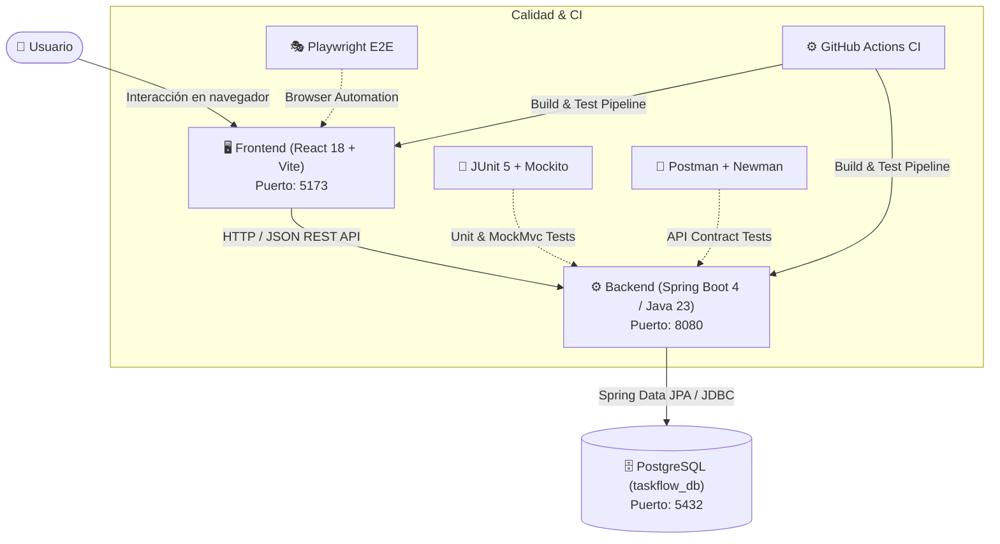

# 🚀 TaskFlow Full Stack

[](https://github.com/eduardoguiroa/taskflow-fullstack/actions)
[](https://www.oracle.com/java/)
[](https://spring.io/projects/spring-boot)
[](https://react.dev/)
[](https://www.postgresql.org/)
[](https://playwright.dev/)
[](https://opensource.org/licenses/MIT)

> **TaskFlow** es una aplicación web full-stack para la organización y seguimiento de actividades personales y profesionales, desarrollada dentro de un **único repositorio de GitHub** que integra de forma integral **Backend**, **Frontend**, **Base de Datos** y **Aseguramiento de Calidad (QA)**.

El propósito central de este proyecto no es crear otro gestor de tareas saturado de opciones, sino demostrar **excelencia en ingeniería de software**: cómo construir, estructurar, conectar y probar exhaustivamente un sistema desacoplado, modular y listo para producción.

---

## 🏛️ 1. Arquitectura del Sistema



---

## 📁 2. Estructura del Repositorio

El proyecto sigue una arquitectura de monorepo donde cada carpeta tiene una responsabilidad única y claramente delimitada:

```text
taskflow-fullstack/
├── .github/workflows/          # Integración Continua (CI Pipeline con GitHub Actions)
├── backend/                    # API REST desarrollada en Java con Spring Boot
│   ├── src/main/java/          # Capas: Controller, Service, Repository, Model, DTO, Exception, Config
│   ├── src/test/java/          # Pruebas unitarias e integración (JUnit 5 + Mockito + H2)
│   ├── pom.xml                 # Configuración de dependencias Maven
│   └── README.md               # Documentación técnica de la API y endpoints
├── frontend/                   # Interfaz de usuario SPA desarrollada con React y Vite
│   ├── src/components/         # Navbar, MetricsGrid, FilterBar, TaskCard, TaskModal, etc.
│   ├── src/api/                # Cliente HTTP para consumo de endpoints REST
│   ├── src/styles/             # Estilos modulares CSS con tema oscuro (Slate theme)
│   └── README.md               # Documentación de la UI, componentes y scripts
├── database/                   # Modelado relacional en PostgreSQL
│   ├── schema.sql              # Definición DDL de tablas, índices, checks y triggers
│   ├── data.sql                # Datos iniciales (seeds) para validación inmediata
│   └── README.md               # Diccionario de datos y diagrama ERD
├── qa/                         # Portafolio completo de aseguramiento de calidad
│   ├── manual/                 # Plan de pruebas, matriz de 20 casos y reportes de defectos
│   ├── automation/             # Automatización de API (Postman/Newman) y E2E (Playwright)
│   └── README.md               # Métricas de ejecución y estrategia de calidad
├── docs/                       # Documentación extendida para reclutadores y diagramas C4
│   ├── architecture/           # Diagramas de secuencia y especificación técnica
│   └── screenshots/            # Galería de capturas de la aplicación
└── README.md                   # Presentación maestra del proyecto
```

---

## ✨ 3. Funcionalidades del Sistema

1. **Dashboard en Tiempo Real**: Cálculo dinámico de métricas consolidadas (Total de tareas, Pendientes, En Progreso y Completadas).
2. **Gestión Integral de Tareas (CRUD)**: Creación con validación reactiva, consulta de detalle, edición de todos los atributos y eliminación permanente.
3. **Control de Estados y Prioridades**:
   - **Estados**: `PENDIENTE` (`PENDING`), `EN PROGRESO` (`IN_PROGRESS`), `COMPLETADA` (`COMPLETED`).
   - **Prioridades**: `BAJA` (`LOW`), `MEDIA` (`MEDIUM`), `ALTA` (`HIGH`).
   - Botón de transición rápida de estado en la propia tarjeta con un solo clic.
4. **Búsqueda y Filtros Combinados**: Barra de búsqueda textual optimizada con debounce (250 ms) y filtrado simultáneo por estado y prioridad.
5. **Experiencia de Usuario (UX)**: Diálogos modales con backdrop blur, confirmación segura de eliminación, notificaciones flotantes contextuales (toasts) y componente para estados sin resultados (`EmptyState`).
6. **Validación en Doble Capa**:
   - En cliente: Bloqueo de envíos vacíos y longitud máxima de 100 caracteres.
   - En servidor: Anotaciones Bean Validation (`@NotBlank`, `@Size`, `@NotNull`) y restricciones nativas `CHECK` en PostgreSQL.

---

## 🛠️ 4. Tecnologías Utilizadas

| Capa / Módulo | Tecnologías | Propósito |
|---|---|---|
| **Frontend** | React 18/19, JavaScript (ES6+), Vite, Lucide Icons, CSS3 | Interfaz de usuario reactiva, modular y responsiva. |
| **Backend** | Java 21/23, Spring Boot 4/3, Spring Data JPA, Hibernate, Bean Validation | Reglas de negocio, API RESTful y transaccionalidad. |
| **Base de Datos** | PostgreSQL 15+/17, PL/pgSQL | Almacenamiento relacional, índices y triggers. |
| **Testing Backend** | JUnit 5, Mockito, MockMvc, H2 Database | Pruebas unitarias de servicios y de integración en controladores. |
| **Testing API** | Postman, Newman CLI | Pruebas de contrato HTTP automatizadas en consola. |
| **Testing E2E** | Playwright (Chromium) | Automatización de flujos de usuario en el navegador. |
| **CI / DevOps** | GitHub Actions | Automatización de compilación y ejecución de pruebas en cada commit. |

---

## 🚀 5. Guía de Instalación y Ejecución Local

### Prerrequisitos
* **Java JDK 21 o 23** instalado.
* **Node.js (v20 o superior)** y **npm** instalados.
* **PostgreSQL** instalado y en ejecución en el puerto `5432`.

---

### Paso 1: Configurar la Base de Datos (PostgreSQL)

1. Abre tu gestor de base de datos (o la consola `psql`) y crea la base de datos:
   ```sql
   CREATE DATABASE taskflow_db;
   ```
2. Aplica el esquema y los datos iniciales desde la raíz del proyecto:
   ```bash
   psql -U postgres -d taskflow_db -f database/schema.sql
   psql -U postgres -d taskflow_db -f database/data.sql
   ```

---

### Paso 2: Iniciar el Backend (Spring Boot)

1. Dirígete a la carpeta `backend/`:
   ```bash
   cd backend
   ```
2. Ejecuta la suite de pruebas unitarias para validar el entorno:
   ```bash
   # En Windows:
   .\mvnw.cmd test
   
   # En Linux / macOS:
   ./mvnw test
   ```
3. Inicia el servidor de desarrollo:
   ```bash
   # En Windows:
   .\mvnw.cmd spring-boot:run
   
   # En Linux / macOS:
   ./mvnw spring-boot:run
   ```
El backend iniciará en: `http://localhost:8080`.

---

### Paso 3: Iniciar el Frontend (React)

1. En una nueva terminal, dirígete a `frontend/`:
   ```bash
   cd frontend
   ```
2. Instala las dependencias:
   ```bash
   npm install
   ```
3. Inicia la aplicación en modo desarrollo:
   ```bash
   npm run dev
   ```
Abre en tu navegador: `http://localhost:5173`.

---

## 🧪 6. Ejecución de Pruebas Automatizadas

### A. Pruebas Unitarias del Backend (JUnit 5 + Mockito)
```bash
cd backend
.\mvnw.cmd test
```
*13 pruebas ejecutadas y aprobadas (Servicios, Controladores MockMvc y contexto Spring).*

### B. Pruebas de API REST con Newman
Con el backend en ejecución (`http://localhost:8080`), corre en la raíz del proyecto:
```bash
npx newman run qa/automation/postman/taskflow-api.postman_collection.json -e qa/automation/postman/taskflow-local.postman_environment.json
```

### C. Pruebas End-to-End con Playwright
Con backend y frontend encendidos:
```bash
cd qa/automation/e2e
npm install
npm test
```

---

## 🎯 7. Estándares de Ingeniería y Principios de Diseño

El proyecto implementa estándares profesionales de desarrollo de software aplicados a lo largo de todo el ciclo de vida:

* **Backend & Arquitectura Limpia**:
  - Arquitectura en capas desacoplada con inversión de dependencias ([`TaskController`](backend/src/main/java/com/taskflow/controller/TaskController.java) ➔ [`TaskService`](backend/src/main/java/com/taskflow/service/TaskService.java) ➔ [`TaskRepository`](backend/src/main/java/com/taskflow/repository/TaskRepository.java)).
  - Modelado de dominio con DTOs inmutables mediante Java Records y validaciones declarativas con Bean Validation.
  - Manejo centralizado y uniforme de excepciones HTTP mediante [`GlobalExceptionHandler`](backend/src/main/java/com/taskflow/exception/GlobalExceptionHandler.java) (`@RestControllerAdvice`).
  - Suite de 13 pruebas automatizadas unitarias y de integración (`JUnit 5`, `Mockito`, `MockMvc`).

* **Frontend & Experiencia de Usuario (UX)**:
  - Interfaz reactiva modular construida con React y empaquetada con Vite para rendimiento óptimo.
  - Gestión de estado centralizado, consumo desacoplado mediante cliente API ([`taskApi.js`](frontend/src/api/taskApi.js)) y optimización de peticiones con búsqueda reactiva debounced.
  - Diseño responsivo con componentes accesibles, diálogos de confirmación destructiva y retroalimentación mediante notificaciones contextuales (*toasts*).

* **Aseguramiento de Calidad (QA) & Automatización**:
  - Estrategia formal de pruebas con [Plan Maestro de Pruebas](qa/manual/test-plan.md) y matriz de 20 casos de prueba ([`test-cases.md`](qa/manual/test-cases.md)).
  - Documentación de ciclo de vida completo de defectos ([`bug-reports/`](qa/manual/bug-reports/)) con análisis de causa raíz y re-test (*Reported ➔ Fixed ➔ Closed*).
  - Pruebas automatizadas de contrato de API REST con Postman y runner Newman para integración continua.
  - Automatización de flujos de navegación end-to-end (E2E) con Playwright.

---

## 🗺️ 8. Estado de la Hoja de Ruta (Checklist de Fases)

- [x] **Fase 01**: Preparar entorno y estructura del repositorio.
- [x] **Fase 02**: Diseñar y preparar la base de datos PostgreSQL (`database/`).
- [x] **Fase 03**: Construir la API REST con Spring Boot (`backend/`).
- [x] **Fase 04**: Construir la interfaz de usuario con React (`frontend/`).
- [x] **Fase 05**: Ejecución y documentación de QA manual (`qa/manual/`).
- [x] **Fase 06**: Automatización de pruebas backend, API y E2E (`qa/automation/`).
- [x] **Fase 07**: Documentación final, capturas y pipeline de GitHub Actions (`.github/workflows/`).

---

## 📄 Licencia

Este proyecto está distribuido bajo la licencia [MIT](LICENSE).
