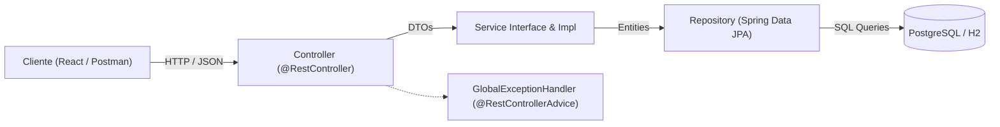

# ⚙️ Módulo Backend — TaskFlow (Spring Boot)

API RESTful desarrollada con **Java 21/23** y **Spring Boot 4**, diseñada bajo principios de arquitectura limpia y separación de responsabilidades.

---

## 🏛️ 1. Arquitectura de Capas



### Estructura de Paquetes (`com.taskflow`)
* **`model/`**: Entidad JPA [`Task`](src/main/java/com/taskflow/model/Task.java) y enumeradores [`TaskPriority`](src/main/java/com/taskflow/model/TaskPriority.java) y [`TaskStatus`](src/main/java/com/taskflow/model/TaskStatus.java).
* **`dto/`**: Java Records inmutables para transferencia de datos:
  * [`TaskRequestDTO`](src/main/java/com/taskflow/dto/TaskRequestDTO.java) (con validaciones `@NotBlank`, `@Size`, `@NotNull`).
  * [`TaskResponseDTO`](src/main/java/com/taskflow/dto/TaskResponseDTO.java) (con mapeador estático desde la entidad).
  * [`TaskMetricsDTO`](src/main/java/com/taskflow/dto/TaskMetricsDTO.java) (`total`, `pending`, `inProgress`, `completed`).
  * [`ErrorResponseDTO`](src/main/java/com/taskflow/dto/ErrorResponseDTO.java) (respuestas de error uniformes).
* **`repository/`**: [`TaskRepository`](src/main/java/com/taskflow/repository/TaskRepository.java) con consultas JPQL para filtrado dinámico (`searchTasks`) y conteos agregados.
* **`service/`**: Contrato [`TaskService`](src/main/java/com/taskflow/service/TaskService.java) e implementación transaccional [`TaskServiceImpl`](src/main/java/com/taskflow/service/impl/TaskServiceImpl.java).
* **`controller/`**: [`TaskController`](src/main/java/com/taskflow/controller/TaskController.java) que expone los endpoints REST bajo `/api/tasks`.
* **`exception/`**: Excepciones personalizadas ([`ResourceNotFoundException`](src/main/java/com/taskflow/exception/ResourceNotFoundException.java)) y controlador global de excepciones ([`GlobalExceptionHandler`](src/main/java/com/taskflow/exception/GlobalExceptionHandler.java)).
* **`config/`**: [`CorsConfig`](src/main/java/com/taskflow/config/CorsConfig.java) habilitando peticiones desde el frontend en `http://localhost:5173` y `http://localhost:3000`.

---

## 📡 2. Contrato de Endpoints de la API REST

| Método | Endpoint | Descripción | Respuestas |
|---|---|---|---|
| `GET` | `/api/tasks` | Listado con filtros opcionales (`?status=...&priority=...&search=...`) | `200 OK` |
| `GET` | `/api/tasks/{id}` | Obtener detalle de una tarea | `200 OK`, `404 Not Found` |
| `GET` | `/api/tasks/metrics` | Métricas del dashboard (`total`, `pending`, `inProgress`, `completed`) | `200 OK` |
| `POST` | `/api/tasks` | Crear una nueva tarea con validación de campos | `201 Created`, `400 Bad Request` |
| `PUT` | `/api/tasks/{id}` | Actualizar una tarea existente | `200 OK`, `400 Bad Request`, `404 Not Found` |
| `DELETE` | `/api/tasks/{id}` | Eliminar una tarea por ID | `204 No Content`, `404 Not Found` |

### Ejemplo de Payload (Crear Tarea - `POST /api/tasks`)
```json
{
  "title": "Diseñar interfaz en React",
  "description": "Crear componentes modulares para filtros y tarjetas.",
  "priority": "HIGH",
  "status": "IN_PROGRESS"
}
```

---

## 🧪 3. Pruebas Automatizadas

El backend incluye una suite de pruebas con JUnit 5 y Mockito:
* **Pruebas de Servicio**: Aisladas con mocks de repositorio para validar reglas de negocio.
* **Pruebas de Controlador**: Con `MockMvc` para validar códigos HTTP de respuesta, serialización JSON y control de errores 400/404.
* **Perfil de Pruebas**: Base de datos en memoria H2 (`application-test.properties`), lo que permite ejecutar pruebas sin requerir que PostgreSQL esté levantado localmente o en pipelines de CI.

Para ejecutar la suite de pruebas:
```bash
./mvnw.cmd test
```

---

## 🚀 4. Ejecución del Servidor

Para iniciar la aplicación conectada a la base de datos PostgreSQL local:
```bash
./mvnw.cmd spring-boot:run
```
El servidor arrancará en: `http://localhost:8080`.
