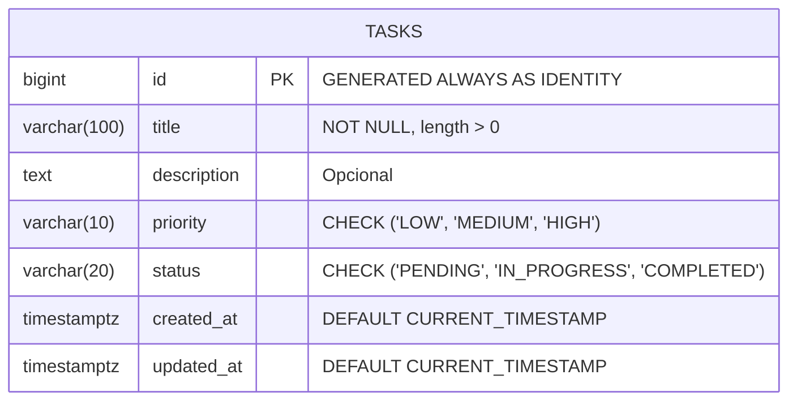

# 🗄️ Módulo de Base de Datos — TaskFlow (PostgreSQL)

Este directorio contiene el diseño del modelo relacional, las definiciones DDL (esquema), los datos de prueba iniciales (seeds) y la guía de configuración local en PostgreSQL.

---

## 1. Diagrama Entidad-Relación (ERD)



---

## 2. Diccionario de Datos (`tasks`)

| Campo | Tipo de Dato | Nulo | Por Defecto | Restricciones / Reglas | Descripción |
|---|---|---|---|---|---|
| `id` | `BIGINT` | No | Auto-incremental | Clave primaria (`PRIMARY KEY`) | Identificador único de la tarea. |
| `title` | `VARCHAR(100)` | No | — | `CHECK (length(trim(title)) > 0)` | Título principal de la tarea. |
| `description` | `TEXT` | Sí | `NULL` | — | Detalle explicativo de la actividad. |
| `priority` | `VARCHAR(10)` | No | `'MEDIUM'` | `CHECK (priority IN ('LOW', 'MEDIUM', 'HIGH'))` | Nivel de urgencia o impacto. |
| `status` | `VARCHAR(20)` | No | `'PENDING'` | `CHECK (status IN ('PENDING', 'IN_PROGRESS', 'COMPLETED'))` | Estado en el flujo de trabajo. |
| `created_at` | `TIMESTAMPTZ` | No | `CURRENT_TIMESTAMP` | — | Fecha y hora exacta de creación. |
| `updated_at` | `TIMESTAMPTZ` | No | `CURRENT_TIMESTAMP` | Mantenido por trigger | Fecha y hora de última modificación. |

### Índices de Optimización
* `idx_tasks_status`: Acelera los filtros por estado y el cálculo de métricas en el Dashboard (`COUNT(*) WHERE status = ?`).
* `idx_tasks_priority`: Optimiza la búsqueda y ordenamiento por urgencia.
* `idx_tasks_created_at`: Agiliza la ordenación cronológica descendente de las tareas en la interfaz.

---

## 3. Guía de Instalación y Configuración Local en Windows

### Opción A: Vía Windows Package Manager (`winget`)
Abre una terminal de PowerShell como Administrador y ejecuta:
```powershell
winget install PostgreSQL.PostgreSQL.17
```

### Opción B: Instalador Oficial
Descarga el instalador gráfico desde [EnterpriseDB / PostgreSQL Downloads](https://www.postgresql.org/download/windows/) para Windows x86-64 y sigue el asistente:
- **Puerto predeterminado**: `5432`
- **Contraseña sugerida para desarrollo**: `postgres` (o la que definas en tu archivo de configuración del backend)

---

## 4. Ejecución de Scripts

Una vez que el servicio de PostgreSQL esté en ejecución, abre una terminal (o la consola interactiva `psql`) para configurar la base de datos:

### Paso 1: Crear la Base de Datos
```sql
CREATE DATABASE taskflow_db;
```

### Paso 2: Conectarse y Aplicar el Esquema DDL
Desde la raíz del proyecto en PowerShell:
```bash
psql -U postgres -d taskflow_db -f database/schema.sql
```

### Paso 3: Cargar Datos de Prueba (Seed Data)
```bash
psql -U postgres -d taskflow_db -f database/data.sql
```

### Paso 4: Validar la Instalación
Puedes comprobar que los datos se insertaron y los índices están activos ejecutando:
```sql
-- Consultar todas las tareas ordenadas por fecha reciente
SELECT id, title, priority, status, created_at FROM tasks ORDER BY created_at DESC;

-- Probar cálculo de métricas para el Dashboard
SELECT 
    COUNT(*) AS total,
    COUNT(*) FILTER (WHERE status = 'PENDING') AS pending,
    COUNT(*) FILTER (WHERE status = 'IN_PROGRESS') AS in_progress,
    COUNT(*) FILTER (WHERE status = 'COMPLETED') AS completed
FROM tasks;
```
