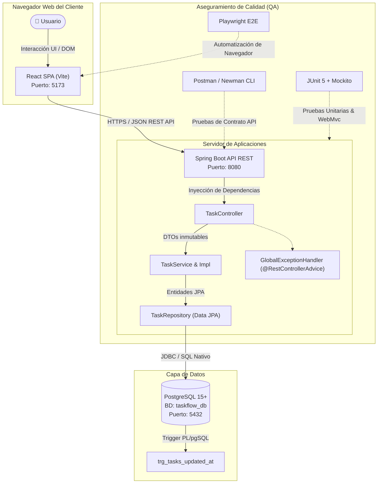
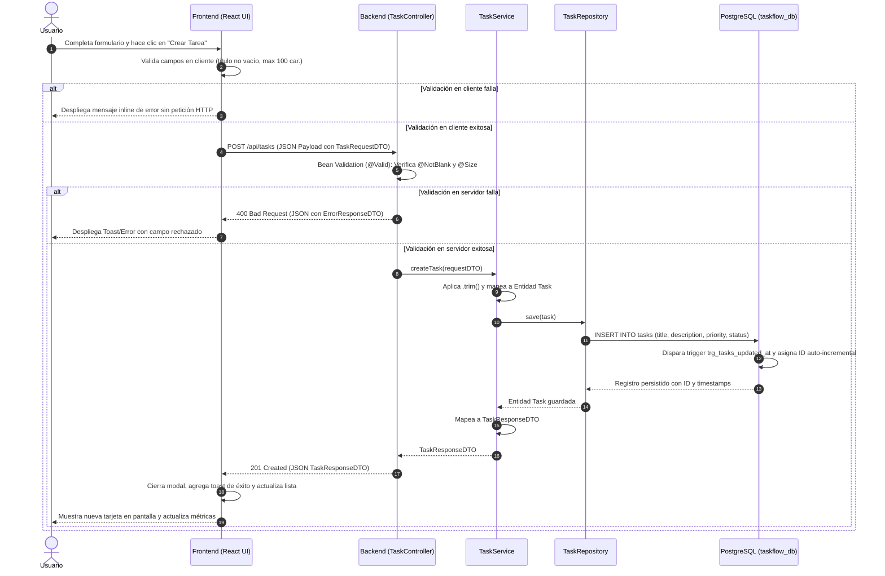

# 🏛️ Documento de Arquitectura del Sistema — TaskFlow

Este documento describe la arquitectura global, patrones de diseño y flujo de datos de **TaskFlow**, concebido bajo principios de diseño limpio, bajo acoplamiento y alta cohesión.

---

## 1. Diagrama de Contenedores (C4 Model)



---

## 2. Diagrama de Secuencia: Flujo de Creación de Tarea

El siguiente diagrama detalla la interacción paso a paso cuando un usuario registra una nueva tarea:



---

## 3. Principios de Diseño Aplicados

### 3.1. Separación de Responsabilidades (SoC)
* **Frontend**: Únicamente gestiona presentación, estado local en UI, accesibilidad y experiencia de usuario.
* **Controlador REST**: Maneja peticiones HTTP, deserialización, códigos de estado y ruteo; no contiene lógica de negocio ni persistencia.
* **Servicio**: Contiene todas las reglas de negocio, validaciones cruzadas, transaccionalidad (`@Transactional`) y mapeos entre DTOs y entidades.
* **Repositorio**: Abstrae las operaciones de acceso a datos mediante Spring Data JPA.
* **Base de Datos**: Ejerce la última línea de defensa con restricciones `CHECK` nativas para evitar estados corruptos incluso ante inserciones SQL directas.

### 3.2. Manejo Centralizado de Excepciones
Mediante [`GlobalExceptionHandler`](../../backend/src/main/java/com/taskflow/exception/GlobalExceptionHandler.java) (`@RestControllerAdvice`), el servidor nunca devuelve stacktraces de Java al cliente. Todos los errores adoptan la estructura estándar:
```json
{
  "timestamp": "2026-10-22T12:00:00Z",
  "status": 400,
  "error": "Validation Failed",
  "message": "Uno o más campos enviados son inválidos",
  "path": "/api/tasks",
  "validationErrors": {
    "title": "El título de la tarea es obligatorio"
  }
}
```

### 3.3. Desacoplamiento de Entidades y DTOs
Los registros Java (`Records`) [`TaskRequestDTO`](../../backend/src/main/java/com/taskflow/dto/TaskRequestDTO.java) y [`TaskResponseDTO`](../../backend/src/main/java/com/taskflow/dto/TaskResponseDTO.java) garantizan inmutabilidad y previenen vulnerabilidades como *Over-Posting* o exposición innecesaria del modelo de persistencia.
