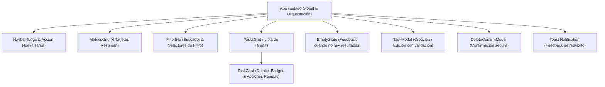

# 🖥️ Módulo Frontend — TaskFlow (React)

Interfaz de usuario moderna y reactiva desarrollada con **React 18/19** y **Vite**, diseñada para una gestión ágil y visual de tareas.

---

## 🏛️ 1. Arquitectura de Componentes



### Estructura del Código Fuente (`src/`)
* **`api/taskApi.js`**: Cliente HTTP desacoplado para interactuar con la API REST de Spring Boot (`/api/tasks`).
* **`components/`**:
  * [`Navbar.jsx`](src/components/Navbar.jsx): Encabezado con identidad de marca y botón de acción principal.
  * [`MetricsGrid.jsx`](src/components/MetricsGrid.jsx): Tarjetas en tiempo real de Total, Pendientes, En Progreso y Completadas.
  * [`FilterBar.jsx`](src/components/FilterBar.jsx): Buscador textual y filtros por Estado y Prioridad con opción de reinicio.
  * [`TaskCard.jsx`](src/components/TaskCard.jsx): Tarjeta individual con chips visuales de prioridad/estado y botón para cambiar de estado rápidamente.
  * [`TaskModal.jsx`](src/components/TaskModal.jsx): Modal reutilizable para crear y editar tareas con validación síncrona en cliente.
  * [`DeleteConfirmModal.jsx`](src/components/DeleteConfirmModal.jsx): Diálogo modal para confirmar la eliminación permanente de una tarea.
  * [`EmptyState.jsx`](src/components/EmptyState.jsx): Mensaje amigable cuando la lista de tareas está vacía o los filtros no devuelven coincidencias.
* **`styles/main.css`**: Hoja de estilos con variables CSS nativas, tema oscuro refinado (Dark Slate), animaciones fluidas y tipografía `Inter`.

---

## 🎨 2. Experiencia de Usuario (UX)

* **Feedback Inmediato**: Toasts contextuales tras cada operación (creación, edición, cambio de estado y eliminación).
* **Búsqueda Dinámica**: Búsqueda textual optimizada con debounce para evitar peticiones redundantes.
* **Estados de Carga**: Indicador animado durante la sincronización de datos con el Backend.
* **Transiciones de Estado de Tareas**: Botón de un solo clic para alternar entre `Pendiente` ➔ `En Progreso` ➔ `Completada` ➔ `Pendiente`.

---

## 🚀 3. Ejecución en Desarrollo

1. Instalar dependencias:
   ```bash
   cd frontend
   npm install
   ```
2. Iniciar el servidor de desarrollo Vite:
   ```bash
   npm run dev
   ```
   La aplicación se abrirá en: `http://localhost:5173`.
3. Construir para producción:
   ```bash
   npm run build
   ```
